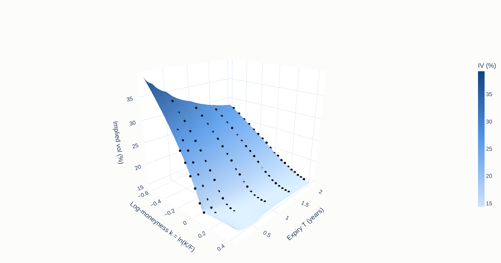
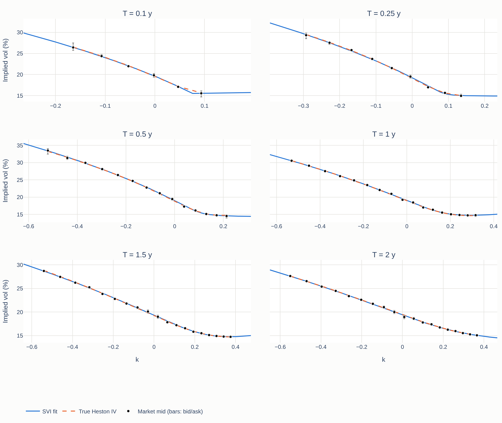
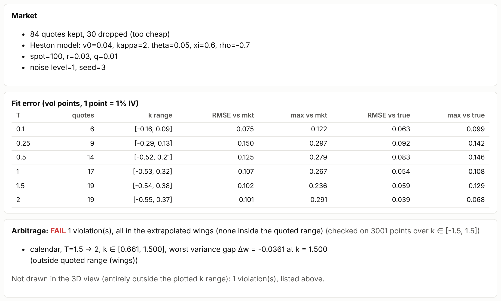
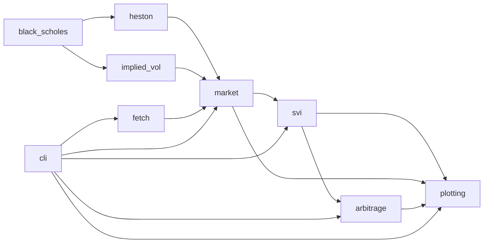

# Volatility Surface Lab

[](https://github.com/SohamMessi10/VolatilitySurfaceLab/actions/workflows/ci.yml)

Volatility Surface Lab (package `volsurface`, command line tool `vsl`) builds an implied-volatility
(IV) surface from a synthetic option market, fits it, and checks the result for static arbitrage.
The market is generated from a Heston stochastic-volatility model, so the true implied vol of every
quote is known. Each expiry is then fitted with a raw SVI ("stochastic volatility inspired",
Gatheral 2004) smile, and the fitted surface is tested
for butterfly arbitrage (Durrleman's condition) and calendar arbitrage (total variance monotone in
maturity). The output is an interactive HTML report.

The numerical core (Black–Scholes, implied-vol solver, Heston pricer, SVI fit, arbitrage checks) is
written on top of numpy and scipy. Measured results are in [Measured results](#6-measured-results);
known weaknesses are in [Limitations](#9-limitations-and-future-work).

Demo: the report pages are in `docs/`. Once GitHub Pages is enabled for the repository, they are
served at <https://sohammessi10.github.io/VolatilitySurfaceLab/> (noisy market) and
<https://sohammessi10.github.io/VolatilitySurfaceLab/clean.html> (noise-free market). The source
files are [`docs/index.html`](docs/index.html) and [`docs/clean.html`](docs/clean.html). Pages is
not enabled yet: the repository owner has to turn it on (see [Enabling the demo](#enabling-the-demo)).

## 1. The problem

A set of option quotes is a set of (strike, expiry, implied vol) points. To price anything else,
or to extract a density, you need a smooth surface through them, and the surface must be free of
static arbitrage or it implies trades with guaranteed profit:

- **Butterfly arbitrage** (within one expiry). Call prices must be convex in strike, which is the
  same as a non-negative risk-neutral density. A smile with a negative implied density prices some
  butterfly spread at a negative value.
- **Calendar arbitrage** (across expiries). At a fixed forward moneyness, total implied variance
  $w = \sigma^2 T$ must not decrease with maturity. Otherwise a calendar spread has negative value.

Fitting each smile independently with a flexible curve usually gives a good fit to the quotes and
no guarantee on either condition, particularly in the wings, where there are no quotes.

Why synthetic Heston data: with real quotes you never know the true surface, so you cannot say how
much of a fit error is the model, the noise or a bug. Here the Heston model generates the prices,
so the true IV is available for every quote and the fit error can be measured against it. The
noise is a seeded perturbation of the mid inside a bid/ask spread (independent uniform draws). It
is a simple model, not a market-microstructure model.

SVI approximates the Heston smile; it does not represent it exactly. The per-slice errors are in
the results section and are not zero.

## 2. Screenshots

These show the market generated with `--noise 1 --seed 3`.



*SVI surface with market points and violation flags (this market has one calendar violation, purely in the extrapolated wings).*



*Per-expiry smiles: SVI fit against market implied vols with bid/ask error bars.*



*Report summary: fit errors per slice and the arbitrage findings with in/out-of-quoted-range flags.*

## 3. Quick start

Requires Python 3.12 or newer (CI tests 3.12 and 3.13). The code is pure Python; numpy 2.5.4 and
scipy 1.18.1 publish macOS arm64 wheels for both versions, so Apple Silicon needs no compiler. The
project itself has been run only on the Linux build container, not on a Mac.

```bash
python -m venv .venv && source .venv/bin/activate
pip install -e ".[dev]"
vsl run --outdir out
```

`vsl run` generates a market, calibrates, checks, and writes the report and intermediate files
into `out/`.

The four stages are also available separately:

```bash
vsl generate -o market.json --csv market.csv --noise 1 --seed 3
vsl calibrate market.json -o fit.json
vsl check fit.json --json report.json          # exit code 1 if arbitrage is found
vsl plot fit.json --market market.json -o surface.html --plotlyjs cdn
```

Heston and market parameters can be overridden on `generate` and `run`:

```bash
vsl run --outdir out --noise 1 --seed 3 --xi 0.8 --rho -0.5 --expiries 0.25,0.5,1,2
```

`--plotlyjs inline` (the default) embeds plotly.js so the report works offline; that file is about
4.9 MB. `--plotlyjs cdn` links plotly.js and gives a file of about 120 kB that needs network access
to render (sizes from `PROGRESS.md`, M7).

### Real data (optional, not verified live)

```bash
pip install -e ".[fetch]"
vsl fetch SPY                 # writes data/spy.json
vsl calibrate data/spy.json -o fit.json
```

`vsl fetch` is for personal use only, in line with the Yahoo Finance terms. Fetched data is
written to `data/`, which is git-ignored, so it is not committed by accident; do not commit or
redistribute it. The live call was **not run**:
the build environment's proxy refuses Yahoo hosts (HTTP 403). The code is tested offline with a
fake chain (`tests/test_fetch.py`) and checked against the installed yfinance source. Treat it as
implemented, not field-tested. Options: `--max-expiries` (8), `--min-days` (7), `--max-days` (730),
`-o`.

### Exit codes

| Code | Meaning |
|------|---------|
| 0 | success / no arbitrage detected |
| 1 | arbitrage detected (`check`, `run`) |
| 2 | usage error |
| 3 | input error (missing/unreadable/malformed file, invalid parameters) |
| 4 | numerical failure (implied vol inversion, Heston pricing, failed SVI fit) |

Expected errors print one line and no traceback.

### Commands (`vsl --help`)

```text
generate   generate a synthetic Heston option market
calibrate  fit SVI to every expiry of a market
check      check fitted slices for butterfly/calendar arbitrage
plot       write the interactive HTML report
run        generate, calibrate, check and plot into a directory
fetch      fetch a real option chain from Yahoo Finance (needs volsurface[fetch]; personal use only)
```

`vsl run --help` options: `--outdir`, `--plotlyjs {inline,cdn}`, `--title`, `--noise`, `--seed`,
`--v0`, `--kappa`, `--theta`, `--xi`, `--rho`, `--spot`, `--r`, `--q`, `--expiries`.

### Enabling the demo

The demo files are committed under `docs/`. GitHub Pages has to be enabled by the repository
owner: Settings, Pages, Build and deployment, Deploy from a branch, branch `main`, folder `/docs`.
The demo pages load plotly.js 4.1.1 from `cdn.plot.ly`. That CDN was not reachable from the build
container, so the live render has to be checked once Pages is on.

## 4. Math summary

**Coordinates.** With forward $F = S e^{(r-q)T}$, discount factor $\mathrm{df} = e^{-rT}$,
log-moneyness $k = \ln(K/F)$ and total standard deviation $s = \sigma\sqrt{T}$, the normalized
undiscounted out-of-the-money price depends only on $(k, s)$:

$$c(k, s) = \frac{C_{\mathrm{OTM}}}{\mathrm{df}\,F}
= \Phi(d_1) - e^{k}\,\Phi(d_2), \qquad d_1 = -\frac{k}{s} + \frac{s}{2},\quad d_2 = d_1 - s$$

(call form for $k \ge 0$; the mirrored put form for $k < 0$). In-the-money prices are obtained from
put–call parity, which keeps the small time value of deep OTM options from being swamped by the
intrinsic value.

**Implied-vol solver.** $c$ is increasing in $s$, convex below the inflection point
$s^* = \sqrt{2|k|}$ and concave above it, so Newton's method started at $s^*$ moves monotonically
toward the root. If normalized vega falls below $10^{-8}$ or a step leaves the bracket, the solver
switches to `scipy.optimize.brentq`. Prices on or outside the model-free bounds raise
`PriceOutOfBoundsError` with the bounds in the message.

**Heston.** Under the pricing measure, with $F_t$ the forward:

$$\frac{dF_t}{F_t} = \sqrt{v_t}\,dW_t, \qquad
dv_t = \kappa(\theta - v_t)\,dt + \xi\sqrt{v_t}\,dZ_t, \qquad d\langle W, Z\rangle_t = \rho\,dt$$

The characteristic function uses the "little trap" form of Albrecher, Mayer, Schoutens and
Tistaert (2007): $g = (\beta - d)/(\beta + d)$ with $e^{-dT}$, so $|g\,e^{-dT}| < 1$ and the complex
logarithm does not jump branches at long maturities. Every factor $1/\xi^2$ is removed using

$$\beta - d = -\frac{\xi^2\,(iu + u^2)}{\beta + d},$$

so there is no cancellation as $\xi \to 0$ and the formula reduces to Black–Scholes at $\xi = 0$.
The complex $\log(1+z)/z$ is evaluated as Kahan's $\log(w)/(w-1)$, because numpy's complex `log1p`
was measured at 6e-8 relative error for $|z| \sim 10^{-9}$.

**Carr–Madan FFT.** Calls use damping $a = +\alpha$ for $k \ge 0$; puts use the mirrored damping
$a = -1-\alpha$ for $k < 0$. On each side the inverse-transform factor $e^{-a k}$ is at most 1, so
OTM time values keep their absolute accuracy, and the mirror puts the integrand's poles at the same
distance from the real axis on both sides. $\alpha$ is capped per expiry at half the admissible
range given by the critical moments (moment explosion time, Andersen and Piterbarg 2007). Where no
usable damping exists, the raw FFT refuses to price; `heston_price(method="auto")`, which the
market generator uses, then switches that expiry to Lewis integration.

**Lewis cross-check.** An independent pricer integrates the Lewis (2001) formula with
`scipy.integrate.quad` on $[0, \infty)$. It verifies the FFT, and it is the fallback when the FFT
has no usable damping: it only needs the moment of order 1/2, which never explodes in Heston.

**Raw SVI** (Gatheral 2004), total variance of one expiry:

$$w(k) = a + b\left(\rho\,(k - m) + \sqrt{(k - m)^2 + \sigma^2}\right)$$

(Here $\sigma$ is SVI's smoothing parameter, the conventional name, not a volatility.)

The optimizer works on $(c, \beta, \rho, m, \sigma)$ with box bounds and sets
$a = c - b\sigma\sqrt{1-\rho^2}$, so the minimum variance is $c \ge 0$ for every point in the box.
Lee's wing bound $b(1+|\rho|) \le 2$ is enforced by writing $b = 2\beta/(1+|\rho|)$ with
$\beta \in [0, 1]$. Both constraints hold exactly, with no penalties or projections.

**Butterfly condition** (Durrleman). With $w'$ and $w''$ the $k$-derivatives of $w$,

$$g(k) = \left(1 - \frac{k\,w'}{2w}\right)^2 - \frac{w'^2}{4}\left(\frac{1}{w} + \frac14\right) + \frac{w''}{2} \;\ge\; 0.$$

$g$ is proportional to the risk-neutral density of log-moneyness (Gatheral and Jacquier 2014;
see the design notes for the exact relation), so
$g \ge 0$ means no butterfly arbitrage in that slice. It is checked on a 3,001-point grid over
$k \in [-1.5, 1.5]$ by default.

**Calendar condition.** $w(k, T_{i+1}) \ge w(k, T_i)$ on the same grid, for each consecutive pair
of expiries.

**Between expiries (plot only).** The 3D surface interpolates total variance linearly in $T$, which
preserves the calendar monotonicity of the fitted slices. It does not extrapolate in $T$.

## 5. Architecture



| File (`src/volsurface/`) | Responsibility |
|---|---|
| `black_scholes.py` | Black–Scholes in forward/log-moneyness coordinates: normalized OTM/call/put price, vega, price bounds, parity gap |
| `implied_vol.py` | Newton-from-inflection solver with Brent fallback, bound checks, scalar fast path, array version |
| `heston.py` | Little-trap characteristic function, Carr–Madan FFT, Lewis integration, critical moments and moment explosion time |
| `market.py` | `MarketSpec`, `Quote`, `MarketData`; seeded bid/ask noise; IV table; JSON/CSV round trip |
| `svi.py` | Raw SVI, constrained parametrization, 18-start least squares with analytic Jacobian, per-slice and per-surface fit |
| `arbitrage.py` | Durrleman butterfly check, calendar check, violation intervals with in/out-of-quoted-range flag |
| `plotting.py` | Plotly 3D surface, smile panels, fit-error table, HTML report (inline or CDN plotly.js) |
| `cli.py` | `vsl` subcommands, argument parsing, exit codes |
| `fetch.py` | Optional Yahoo chain via yfinance; forward and discount factor implied by put–call parity |

## 6. Measured results

All numbers are from `benchmarks/results.json` (written by `python benchmarks/bench.py`) and
`PROGRESS.md`. Machine: cloud container, Linux x86_64, Intel Xeon @ 2.30 GHz, 4 vCPU, Python 3.12.3,
numpy 2.5.4, scipy 1.18.1. Timings on other machines will differ; run `python benchmarks/bench.py`
to reproduce them on yours.

### Implied-vol solver

20,000 random cases, seed 0: $k \in [-3, 3]$, $\sigma \in [1\%, 300\%]$, $T$ from 1 day to
10 years, $F \in [1, 1000]$, $\mathrm{df} \in [0.5, 1]$, calls and puts.

| Quantity | Value |
|---|---|
| Solved | 19,625 |
| Rejected (time value below double-precision resolution) | 375 |
| Solved by Newton | 87.6% |
| Solved by Brent fallback | 12.4% |
| Max relative vol error (resolvable cases) | 7.3e-10 |
| Median relative vol error (resolvable cases) | 3.9e-16 |
| Time per inversion | 11.1 µs |

"Resolvable" means the time value is larger than $10^{-8}$ of the price.

### Heston pricer: FFT against Lewis integration

Parameters $v_0 = 0.04$, $\kappa = 2$, $\theta = 0.05$, $\xi = 0.6$, $\rho = -0.7$; 26 strikes on
$k \in [-1.5, 1]$; FFT with $N = 2^{15}$, $\eta = 0.1$, $\alpha = 1.5$ (the cap described above can
lower $\alpha$ per expiry).

| T (years) | Max abs error vs Lewis, divided by F |
|---|---|
| 0.05 | 1.5e-11 |
| 0.25 | 4.5e-12 |
| 1 | 3.5e-12 |
| 3 | 1.0e-12 |
| 10 | 7.8e-14 |

| Pricer | Measured time | Per 26-strike expiry |
|---|---|---|
| FFT (calls and puts) | 21.1 ms per expiry | 21.1 ms |
| Lewis (`quad`) | 6.5 ms per strike | about 170 ms (26 × 6.5 ms, derived) |

`PROGRESS.md` also records agreement of the characteristic function with a Riccati-ODE reference
(|Δφ| < 1e-12, including T = 10) and a Black–Scholes limit at $\xi = 0$ (below 2e-11 for the FFT).

### SVI fit error on the clean market

Default market: S = 100, r = 3%, q = 1%, expiries 0.1 to 2 years, strikes 60% to 150% of spot,
noise 0. 84 quotes are kept and 30 dropped (true price below 0.05). With noise 0 the market IV
equals the true Heston IV, so error against the market and against the true IV are the same
numbers. Units are vol points (1 = one percentage point of implied vol).

| T | Quotes | RMSE | Max abs error |
|---|---|---|---|
| 0.1 | 6 | 0.029 | 0.047 |
| 0.25 | 9 | 0.059 | 0.079 |
| 0.5 | 14 | 0.052 | 0.082 |
| 1.0 | 17 | 0.0078 | 0.012 |
| 1.5 | 19 | 0.00097 | 0.0017 |
| 2.0 | 19 | 0.0012 | 0.0020 |

SVI approximates the Heston smile and does not recover it exactly. The error is largest at short
and intermediate maturities; `PROGRESS.md` notes this is consistent with SVI being the
large-maturity limit of Heston (Gatheral and Jacquier 2011). On data generated by SVI itself the
round trip is exact to about 5e-15 vol points (`PROGRESS.md`, M5), so the errors above are model
mismatch, not optimizer error.

### Pipeline timings (clean market)

| Stage | Time |
|---|---|
| Generate (84 quotes) | 0.15 s |
| Calibrate (6 slices) | 1.00 s |
| Arbitrage check (3,001-point grid) | 0.001 s |

The clean fitted surface is arbitrage-free on the full grid $k \in [-1.5, 1.5]$.

### Noisy markets and arbitrage

20 markets with `noise = 1`, seeds 0 to 19, relative half-spread 2%.

| Outcome | Result |
|---|---|
| Arbitrage-free inside the quoted range | 20 / 20 |
| Arbitrage-free on the full extrapolated grid $k \in [-1.5, 1.5]$ | 3 / 20 |
| Worst SVI error vs true IV | 0.495 vol points |
| Median calibration time | 1.23 s |

Read the 3 / 20 result carefully. Each expiry is fitted independently, which does not guarantee
arbitrage-free extrapolation beyond the quotes. In the demo market (seed 3) the single violation
is a calendar violation purely in the extrapolated wings.

## 7. Verification

`pytest` collects 148 tests across 10 modules; all pass locally and in CI. Hypothesis is used for property tests.
Because Hypothesis draws new examples on every run, the property tests were also run under 40
different seeds with no failures. That stress run is how a flaky tolerance was found and fixed:
near the money with small total vol, the put price $e^k\Phi(-d_2) - \Phi(-d_1)$ subtracts two
numbers close to 0.5, and the test's tolerance now uses the condition number of that subtraction.

| Module | What the tests check |
|---|---|
| `black_scholes` | Textbook reference prices (Hull's S = K = 100, T = 1, r = 5%, σ = 20% example); vega against finite differences; parity on a grid; price bounds; vol limits; strike monotonicity and convexity; deep-OTM time value; put/call symmetry |
| `implied_vol` | Textbook recovery; Newton iteration count near the money; Brent fallback with tiny vega; bound rejection and messages; array version with NaNs; price-IV-price round trip; scalar versus vectorized path |
| `heston` | CF normalization and martingale property; CF against Riccati ODE; the original Heston formula's branch cut at long T; FFT against Lewis; unusable damping rejected; moment explosion time against ODE; Black–Scholes limit; parity between independent call and put FFTs; monotone, convex prices |
| `market` | Default counts; noise 0 is deterministic and matches Lewis IVs; seed reproducibility; bid, mid, ask ordering; OTM selection; JSON/CSV round trips; skew; spec validation |
| `svi` | Derivatives against finite differences; analytic Jacobian; exact round trip; recovery over random valid parameters; constraints hold on noisy fits; determinism; weights; flat smile; minimum five points |
| `arbitrage` | Clean slice passes; Axel Vogt's butterfly-arbitrage example (from Gatheral and Jacquier 2014) detected; clean and injected calendar pairs; JSON report |
| `pipeline` | Clean Heston surface passes; injected calendar and butterfly violations located; noisy market has no arbitrage inside the quoted range; report serializes |
| `plotting` | Figure traces; surface grid includes expiries and does not extrapolate; interpolated variance monotone in T; violation markers; CDN and inline HTML; HTML escaping |
| `cli` | End-to-end commands; CSV input; CDN and inline; arbitrage exit code; missing, malformed and invalid inputs; usage errors; output directories created; `fetch` error paths |
| `fetch` | Expiry filtering; parity recovers forward and discount factor; OTM selection; bad quotes dropped; fallback with too few strikes; JSON round trip. All against a fake chain |

**CI** (`.github/workflows/ci.yml`): on push to `main`, pull requests and manual dispatch, a matrix
of Python 3.12 and 3.13 runs `ruff check .`, `ruff format --check .` and `pytest -q`.

## 8. Design decisions

**Why the "little Heston trap".** The original Heston (1993) characteristic function takes a complex
logarithm that can jump branches at long maturities, which gives an O(1) error. The formulation of
Albrecher et al. (2007) uses $e^{-dT}$ so the argument of the log stays on the principal branch.
A test asserts this at T = 10, where the original formula is off by O(1). A second step removes
every $1/\xi^2$ with the identity above, so the formula stays accurate as $\xi \to 0$ and matches
Black–Scholes at $\xi = 0$. Both changes are algebraic and do not rely on tolerances.

**Why total implied variance.** Both no-arbitrage conditions are simple in $w = \sigma^2 T$: the
calendar condition is monotonicity in $T$, and Durrleman's $g$ is written in $w$ and its
$k$-derivatives. The wings of $w$ are asymptotically linear in $k$ (Lee's moment formula), which
SVI represents directly. Fitting in $w$ also keeps residuals comparable across expiries and avoids
dividing by $T$. Interpolating linearly in $w$ between expiries preserves calendar monotonicity.

**SVI constraints, enforced exactly.** Instead of penalties, the parametrization makes invalid
parameter sets unrepresentable. $a = c - b\sigma\sqrt{1-\rho^2}$ makes the minimum variance equal
$c \ge 0$. $b = 2\beta/(1+|\rho|)$ with $\beta \in [0,1]$ gives $b(1+|\rho|) \le 2$, Lee's bound on
the wing slope. The optimizer only ever sees valid slices. This rules out negative variance and
wings steeper than Lee's bound, but it does not make the surface arbitrage-free: the butterfly and calendar
conditions still have to be checked, and are.

**The Durrleman condition.** The risk-neutral density of log-moneyness is
$g(k)/\sqrt{2\pi w}\,\exp(-d_-^2/2)$ with $d_- = -k/\sqrt{w} - \sqrt{w}/2$, i.e. $d_2$ written
in total variance (Gatheral and Jacquier 2014). The square root and the
exponential are positive, so the density has the sign of $g$. That makes $g \ge 0$ the condition
for no butterfly arbitrage in a slice, and it needs only $w$, $w'$ and $w''$, all of which SVI
gives in closed form. Violations are reported as contiguous intervals in $k$ with the worst point
and value.

**Newton versus Brent.** Newton on vega is fast near the money and unreliable when vega is tiny
(deep OTM, short expiry). Starting at the inflection point $s^*$ makes the iteration monotone, and
when vega collapses the solver hands a bracket to Brent. In the benchmark above 87.6% of the cases
finish with Newton and 12.4% need Brent, at 11.1 µs per inversion on average. At the far end,
prices whose time value is below double-precision resolution are rejected rather than guessed.

**Found in testing: moment explosion that mispriced silently.** An FFT with damping $\alpha = 3$ at
$T = 3$ returned a price off by 0.068 with no NaN and no warning, because the damped transform
was outside the region where the moment exists. The fix computes critical moments per expiry from
the Andersen–Piterbarg explosion time (checked against the Riccati ODE to relative 1e-5), caps
$\alpha$ at half the admissible range, and raises an error that points to the Lewis method when no
usable damping exists.

**Found in testing: Lee bound after wing arbitrage.** The SVI fit originally had no wing bound. A
noisy 6-quote slice at $T = 0.1$ had extrapolated wings reaching $g(k) = -7.8$, creating butterfly
and calendar arbitrage outside the quotes. The $b(1+|\rho|) \le 2$ constraint, built into the
reparametrization, fixed that case. It does not fix extrapolation in general, as the 3 / 20 figure
shows.

## 9. Limitations and future work

Limitations:

- **Extrapolation is not arbitrage-free.** On 20 noisy markets the fitted surface was
  arbitrage-free inside the quoted range 20 / 20 times and on the full grid $k \in [-1.5, 1.5]$
  only 3 / 20 times. Independent per-slice SVI fits do not guarantee arbitrage-free extrapolation.
- **SVI is an approximation.** On the clean market the maximum error against the true Heston IV is
  0.082 vol points at $T = 0.5$ and 0.0017 to 0.002 at $T \ge 1.5$.
- **The noise model is simple:** independent uniform perturbations of the mid inside a bid/ask
  spread, with no stale quotes, no autocorrelation and no arbitrage-consistent noise.
- **The IV solver rejects prices whose time value is below double-precision resolution** (375 of
  20,000 in the benchmark), and far in the wings with tiny total vol the direct Black formula loses
  digits to cancellation (noted in `PROGRESS.md`, M2). Jäckel's "Let's Be Rational" is the
  reference for a solver that avoids this; it is not implemented here.
- **No vega or bid/ask weighting** is used by `vsl calibrate`.
- **Real-data fetch is unverified live.** `vsl fetch` was not run against Yahoo here. It estimates
  forward and discount factor by put–call parity, which is approximate for American-style equity
  options, and applies no early-exercise adjustment.
- **Timings are from one cloud container** and will differ on other hardware.
- **No Heston calibration:** the Heston parameters are inputs to the generator, not outputs of a fit.

Future work:

- SSVI / eSSVI joint calibration, to get arbitrage-free extrapolation across expiries.
- Vega or bid/ask-spread weighting in the fit.
- An American-exercise adjustment for real equity chains.
- Heston calibration to a market surface.
- Local-vol extraction via Dupire from the arbitrage-free surface.
- Analytic Heston gradients for calibration.

## 10. Project layout

```text
VolatilitySurfaceLab/
├── .github/workflows/ci.yml     ruff + pytest on Python 3.12 and 3.13
├── benchmarks/
│   ├── bench.py                 reproduces the timings and accuracy figures
│   └── results.json             output of bench.py on the machine named above
├── docs/                        GitHub Pages demo
│   ├── index.html               noise 1, seed 3
│   ├── clean.html               noise 0
│   └── img/                     screenshots used in this README
├── src/volsurface/
│   ├── black_scholes.py
│   ├── implied_vol.py
│   ├── heston.py
│   ├── market.py
│   ├── svi.py
│   ├── arbitrage.py
│   ├── plotting.py
│   ├── cli.py
│   └── fetch.py
├── tests/                       10 test modules
├── PROGRESS.md                  milestone ledger with measurements
├── pyproject.toml
└── LICENSE
```

## License

MIT. See [LICENSE](LICENSE).

## References

- S. L. Heston (1993), A closed-form solution for options with stochastic volatility with applications to bond and currency options, *Review of Financial Studies* 6(2).
- H. Albrecher, P. Mayer, W. Schoutens and J. Tistaert (2007), The little Heston trap, *Wilmott Magazine*, January.
- P. Carr and D. Madan (1999), Option valuation using the fast Fourier transform, *Journal of Computational Finance* 2(4).
- J. C. Hull, *Options, Futures, and Other Derivatives* (Black–Scholes reference example used in the tests).
- R. W. Lee (2004a), Option pricing by transform methods: extensions, unification and error control, *Journal of Computational Finance* 7(3).
- R. W. Lee (2004b), The moment formula for implied volatility at extreme strikes, *Mathematical Finance* 14(3).
- A. L. Lewis (2001), A simple option formula for general jump-diffusion and other exponential Lévy processes, SSRN working paper.
- L. Andersen and V. Piterbarg (2007), Moment explosions in stochastic volatility models, *Finance and Stochastics* 11.
- J. Gatheral (2004), A parsimonious arbitrage-free implied volatility parameterization with application to the valuation of volatility derivatives, Global Derivatives presentation.
- J. Gatheral and A. Jacquier (2011), Convergence of Heston to SVI, *Quantitative Finance* 11(8).
- J. Gatheral and A. Jacquier (2014), Arbitrage-free SVI volatility surfaces, *Quantitative Finance* 14(1).
- V. Durrleman (2010), From implied to spot volatilities, *Finance and Stochastics* 14 (from his 2004 Princeton PhD thesis); the butterfly condition in the form used by Gatheral and Jacquier (2014).
- P. Jäckel (2015), Let's be rational, *Wilmott Magazine*. Cited as the reference for the IV-solver limitation; not implemented here.
